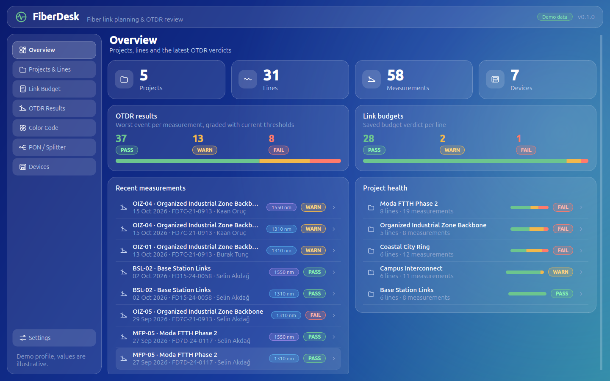
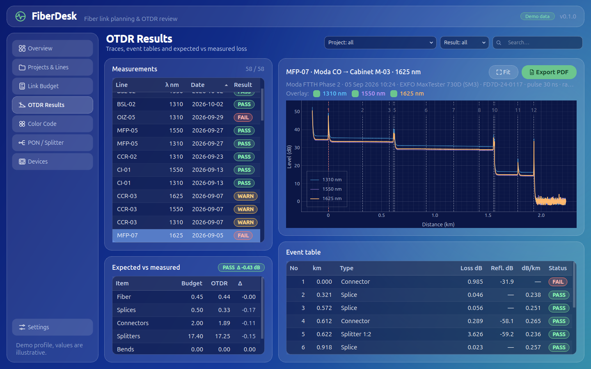
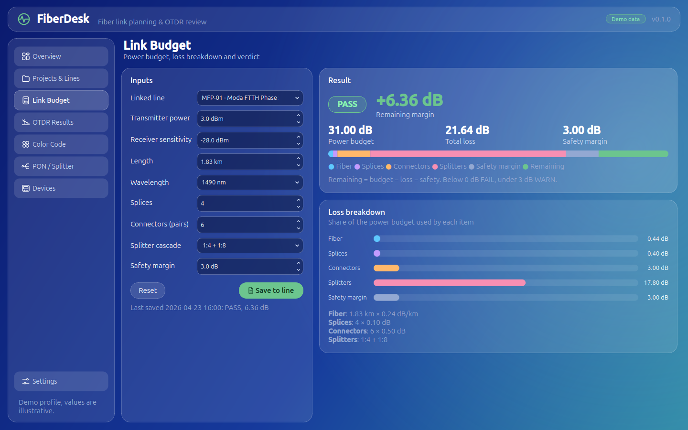
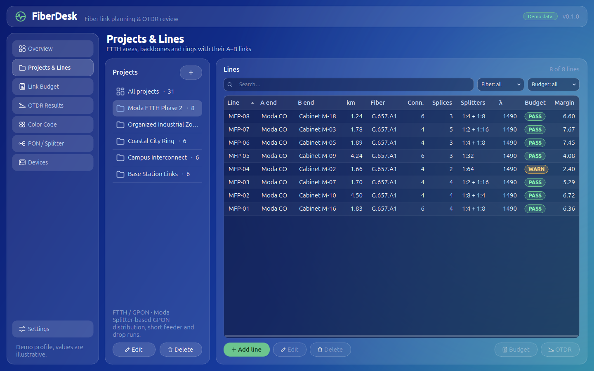
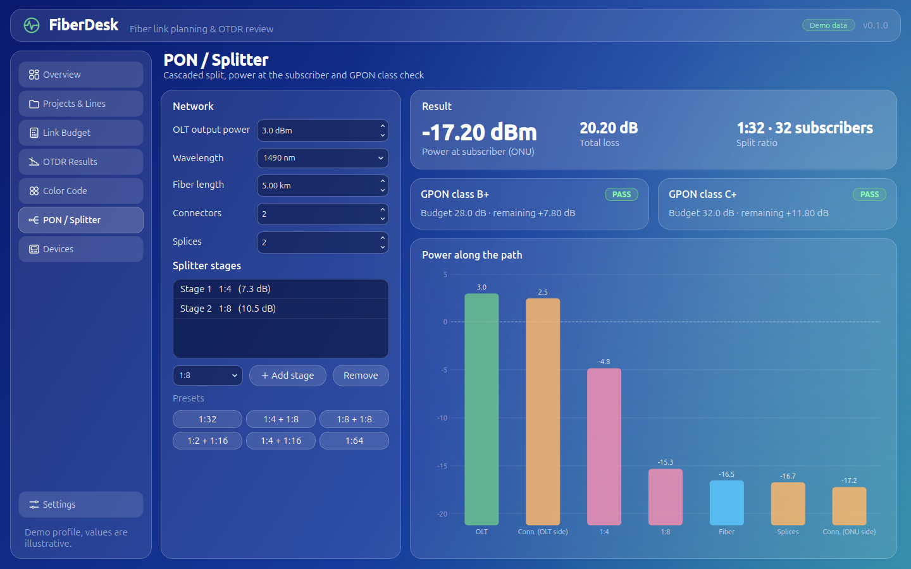
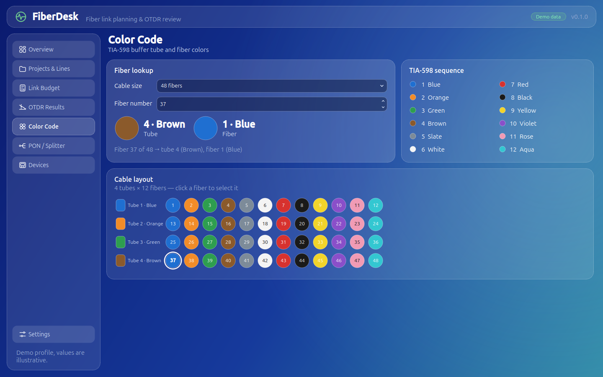
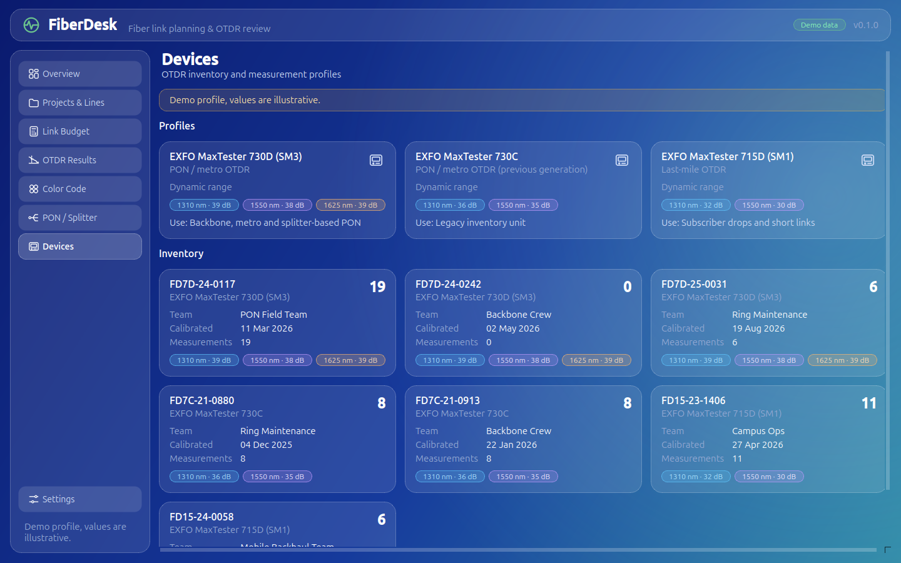
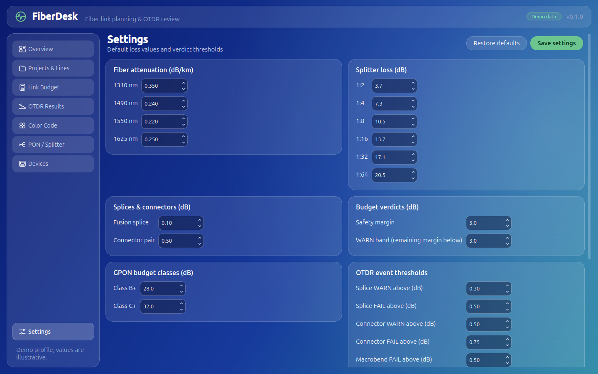
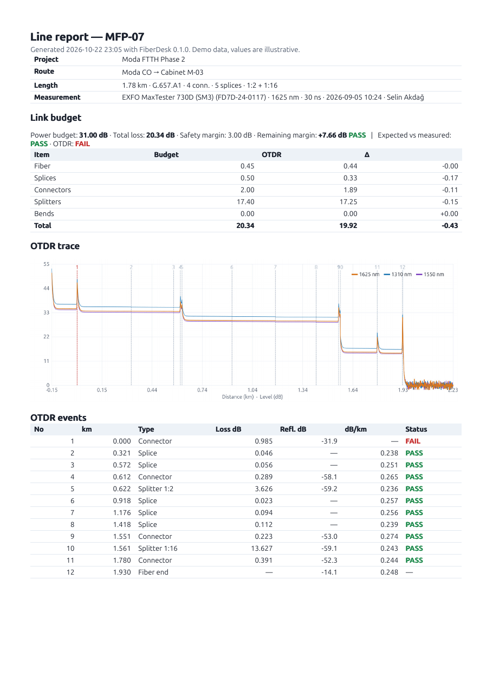

# FiberDesk

A desktop app for planning fiber links and reviewing OTDR results. It works fully offline and is built with Python and PySide6 (Qt).

FiberDesk calculates link budgets and PON splitter cascades, shows OTDR traces with their event tables, and compares a line's planned loss with what the OTDR measured. It also includes a TIA-598 colour code guide. It is meant for field technicians, link-planning engineers and trainers.

> **Demo data only.** Every project, line, measurement, operator and serial number is fictional. A fixed seed generates them. Device profiles are modelled on the EXFO MaxTester series. They are *demo profiles, and the values are illustrative*. They are not manufacturer specifications.



## Features

| Screen | What it does |
|---|---|
| **Overview** | Counts of projects, lines, measurements and devices; PASS / WARN / FAIL distribution for OTDR results and saved link budgets; recent measurements; per-project health. |
| **Projects & Lines** | Projects (an FTTH area, a backbone…) with their A–B lines: length, fiber type (G.652.D / G.657.A1), connectors, splices, splitter cascade, optics. Add / edit / delete, search and filters. |
| **Link Budget** | Tx power, Rx sensitivity, length, wavelength, splices, connectors, splitter cascade, safety margin. Shows total loss, remaining margin, verdict and a loss breakdown chart. Results can be saved to a line. |
| **OTDR Results** | Measurement list with filters; a zoomable trace (distance km vs level dB) with event markers. Other wavelengths of the same line (1310 / 1550 / 1625 nm) can be overlaid. The event table shows type, loss, reflectance and section attenuation, coloured by threshold. Line budget vs OTDR loss is shown side by side. One-page PDF report. |
| **Color Code** | TIA-598 lookup (e.g. fiber 37 of 48 → tube 4 Brown, fiber 1 Blue) and the full tube × fiber grid for 12–144 fiber cables. |
| **PON / Splitter** | Cascaded split (e.g. 1:4 + 1:8). Shows OLT power down to subscriber power, total loss and the GPON class B+ / C+ verdict, with a power-along-the-path chart. |
| **Devices** | OTDR profiles (wavelengths, dynamic range) and the device inventory with calibration dates and measurement counts. |
| **Settings** | Every default value and threshold below can be edited; verdicts are recalculated immediately. |

<table>
<tr><td></td><td></td></tr>
<tr><td></td><td></td></tr>
<tr><td></td><td></td></tr>
<tr><td></td><td></td></tr>
</table>

## Getting started

Requires Python 3.12+ on Linux (developed on Ubuntu).

```bash
git clone https://github.com/asunode/fiberdesk.git
cd fiberdesk
python3 -m venv .venv
.venv/bin/pip install -r requirements.txt
.venv/bin/python -m fiberdesk
```

On first start the app creates `data/fiberdesk.db` and fills it with the demo data set.

Useful options:

```bash
python -m fiberdesk --reseed              # rebuild the demo data, then start
python -m fiberdesk --db /path/to/my.db   # use another database file
python -m fiberdesk.storage.seed          # rebuild the demo data without starting the UI
python -m fiberdesk --screenshots out/    # save a PNG of every screen and exit
```

You can also rebuild the demo data from **Settings → Demo data**. `FIBERDESK_DB` overrides the database path. An installed package (`pip install .`) stores its database in `~/.local/share/fiberdesk/`.

## Calculation model

### Default values (editable in Settings)

| Item | Value |
|---|---|
| Fiber attenuation 1310 / 1490 / 1550 / 1625 nm | 0.35 / 0.24 / 0.22 / 0.25 dB/km |
| Fusion splice | 0.10 dB (WARN above 0.30, FAIL above 0.50) |
| Connector pair | 0.50 dB (WARN above 0.50, FAIL above 0.75) |
| Splitter 1:2 / 1:4 / 1:8 / 1:16 / 1:32 / 1:64 | 3.7 / 7.3 / 10.5 / 13.7 / 17.1 / 20.5 dB |
| GPON class B+ / C+ budget | 28 / 32 dB |
| Safety margin | 3 dB |
| WARN band | remaining margin 0–3 dB |
| Reflectance | WARN above −45 dB, FAIL above −35 dB |
| Macrobend | always at least WARN, FAIL above 0.5 dB |
| Splitter tolerance | WARN above nominal + 1 dB, FAIL above nominal + 2 dB |

### Link budget

```
power budget  = Tx power − Rx sensitivity
total loss    = length × attenuation(λ) + splices × splice loss
                + connectors × connector loss + Σ splitter loss
remaining     = power budget − total loss − safety margin
verdict       = FAIL if remaining < 0, WARN if remaining < WARN band, else PASS
```

### PON

The OLT output power minus the losses along the path gives the power at the ONU. The total loss is compared with the B+ and C+ class budgets, using the same WARN band.

### OTDR

Each measurement is stored as a list of events (connector, splice, macrobend, splitter, fiber end) with distance, loss, reflectance and the attenuation of the preceding section. The event table is that list, and the trace is synthesised from the same list with a fixed seed, so the two always agree. A measurement's result is its worst event.

**Expected vs measured** compares the line's budget at the measurement wavelength with the OTDR link loss from the A to the B connector, category by category. If the measurement exceeds the expected total by more than 0.5 dB it is WARN; by more than 1.5 dB it is FAIL.

Demo traces use a simple model: backscatter slope, step losses, reflective peaks, an end reflection with a drop to the noise floor, and noise that grows with distance. Macrobends lose much more at 1550/1625 nm than at 1310 nm, as they do in real fiber.

## Tests

```bash
.venv/bin/python -m pytest
```

The suite covers the calculation core (budget, splitter / PON, colour code, OTDR events and traces), the database layer and demo seed, and an offscreen smoke test of every screen, including PDF export.

## Project layout

```
fiberdesk/
  core/        calculation core — pure Python + numpy, no Qt
  storage/     SQLite repository and the demo data generator
  ui/          PySide6 window, pages, widgets, theme, PDF report
  i18n.py      every user-facing string (add a language here)
tests/         pytest suite
screenshots/   real screenshots of the app
```

## Out of scope

FiberDesk does not connect to instruments and does not parse `.sor` / `.trc` files. There is no cloud, user account, web or mobile version.

## License

[MIT](LICENSE). EXFO and MaxTester are trademarks of their respective owner. This project is not affiliated with or endorsed by EXFO.
